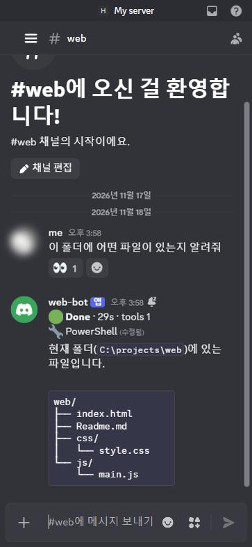
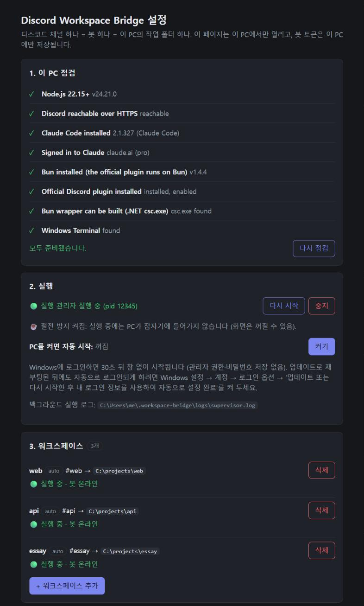

# Discord Workspace Bridge

**휴대폰의 디스코드로 PC의 Claude Code 워크스페이스에 일을 시키는 도구입니다.**
채널 하나 = 봇 하나 = PC의 작업 폴더 하나. PC는 켜 두기만 하고, 밖에서 폰으로 작업을 요청하고, 진행 상황과 결과를 보고, 승인 버튼을 누릅니다.

[English](README.en.md)

<!-- screenshot: docs/images/demo.gif (선택) -->


```
 📱 폰의 디스코드                       🖥️ 집·사무실 PC (켜 둠)
 ├ #web     ← web-bot    ─────────▶  claude (C:\projects\web)
 ├ #api     ← api-bot    ─────────▶  claude (C:\projects\api)
 └ #control ← manager-bot ────────▶  실행 관리자: 상태·재시작·알림
```

- **Anthropic 공식 구성 요소를 그대로 사용**: 각자 자기 Claude 구독(Pro/Max)으로 로그인한 공식 `claude`와 Anthropic의 공식 디스코드 채널 플러그인을 실행합니다. 이 프로그램은 **Claude 로그인 정보를 읽거나 저장하지 않습니다.**
- **설정 페이지**: 봇 토큰 확인, 초대 감지, 채널·폴더 선택까지 브라우저에서 한 단계씩 안내합니다.
- **창 없이 계속 실행**: 자동 재시작, 대화 이어 가기, Windows 로그인 시 자동 시작, 절전 방지.
- **진행 표시**: 작업 중이면 채널에 `🟡 Running · tools 7` 메시지가 조용히 갱신되고, 끝나면 답장으로 알림.
- **폰에서 관리**: `#control`에서 `/dashboard`, `/stop`, `/restart`, `/new`, `/mode`, `/logs`, `/ping`, `/lockdown`과 장애 알림.
- **안전한 기본값**: 내 계정만 명령 가능, 봇마다 자기 채널만 처리, 위험한 작업은 DM으로 승인 요청, 폴더 신뢰는 사람이 직접 확인.

> 이 프로젝트는 Anthropic이 만들거나 보증한 것이 아닙니다. Claude Code를 실행하는 비공식 도구입니다.

## 빠른 시작 (Windows)

준비물: Claude Pro/Max 구독, [Claude Code](https://code.claude.com/docs/en/quickstart)(로그인까지), [Node.js](https://nodejs.org) 22.15+, [Bun](https://bun.sh), 공식 디스코드 플러그인, 디스코드 개인 서버. 자세히: [1. 준비물](docs/01-requirements.md)

```bash
git clone https://github.com/wholedit/Discord_Workspace_Bridge.git
```

```bash
cd Discord_Workspace_Bridge
```

```bash
npm install
```

```bash
npm run setup
```

브라우저에 설정 페이지가 열리면 안내대로 따라 하세요. PC 점검 → 봇 만들기 → 토큰 → 초대 → 채널 → 폴더 → 실행 → 자동 시작.



## 문서

| | |
|---|---|
| [1. 준비물](docs/01-requirements.md) | Claude Code, Bun, 공식 플러그인, 디스코드 준비 |
| [2. 설치와 설정](docs/02-setup.md) | 설정 페이지 단계별 설명, 터미널로 설정하기 |
| [3. 사용법](docs/03-usage.md) | 작업 채널, 승인, 권한 모드, 관리 명령, 알림, PC 명령 |
| [4. 폰에서 쓰기](docs/04-mobile-guide.md) | 알림 설정, 채널 구성, 자주 쓰는 흐름 |
| [5. 보안](docs/05-security.md) | 꼭 할 것, 기본 보호 장치, 폰 분실 대처 |
| [6. 계속 켜 두기](docs/06-run-as-service.md) | 백그라운드 실행, 자동 시작, 절전 방지, 업데이트 |
| [7. 문제 해결](docs/07-troubleshooting.md) | 봇 오프라인, 플러그인 실패, 네트워크 등 |

## 자주 쓰는 명령

| 명령 | 하는 일 |
|---|---|
| `npm run setup` | 설정 페이지 |
| `npm run start:bg` / `npm run stop` | 백그라운드 실행 / 종료 |
| `npm run status` / `npm run logs` | 상태 / 로그 |
| `npm run autostart -- on` | Windows 로그인 시 자동 시작 |

전체 명령: [3. 사용법](docs/03-usage.md#pc-명령-모음)

## 요금

이 프로그램은 무료(MIT 라이선스)입니다. Claude 사용량은 각자의 Claude 구독에서 차감됩니다.

## 상태

v0.1.0. Windows 10/11에서 검증했습니다. macOS·Linux는 아직 검증하지 않았습니다. 디스코드 채널 기능은 Claude Code의 연구 프리뷰라 사양이 바뀔 수 있습니다.

기여: [CONTRIBUTING.md](CONTRIBUTING.md) · 보안 제보: [SECURITY.md](SECURITY.md) · 변경 기록: [CHANGELOG.md](CHANGELOG.md) · 개발 기록: [docs/dev](docs/dev/PLAN.md)
