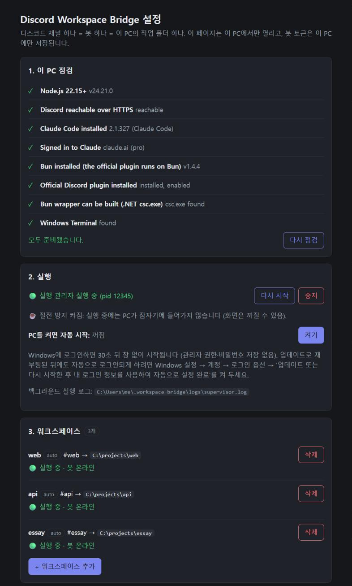
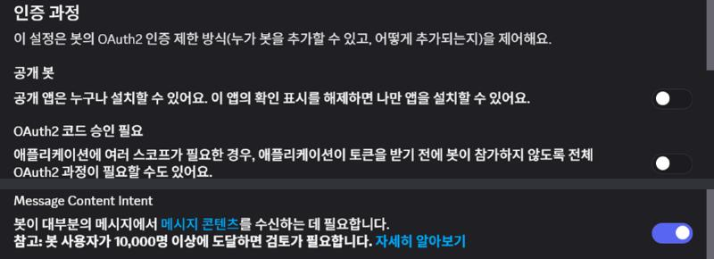
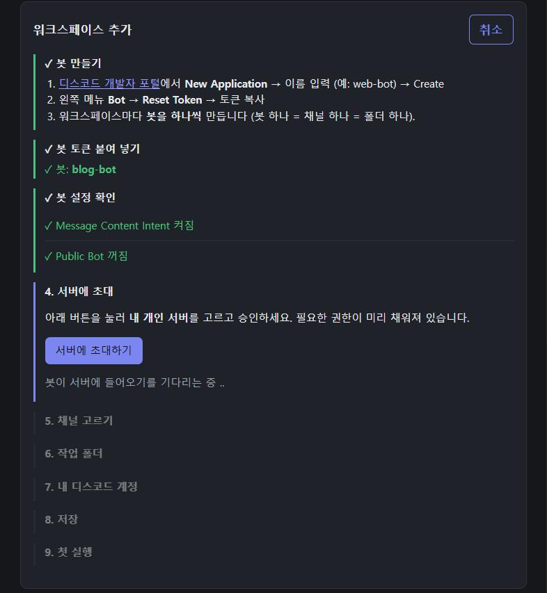
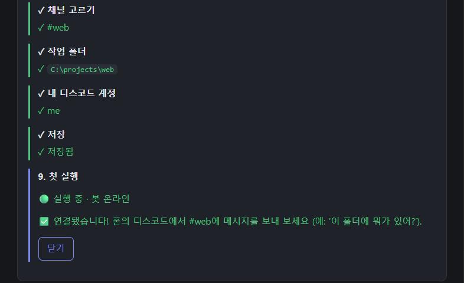

# 2. 설치와 설정

준비물([1. 준비물](01-requirements.md))을 갖췄다면 10분 정도면 첫 워크스페이스를 연결할 수 있습니다.

## 1) 받기

```bash
git clone https://github.com/wholedit/Discord_Workspace_Bridge.git
```

```bash
cd Discord_Workspace_Bridge
```

```bash
npm install
```

## 2) 설정 페이지 열기

```bash
npm run setup
```

브라우저에 설정 페이지가 열립니다. 안 열리면 터미널에 나온 링크를 **이 PC의** 브라우저에 붙여 넣으세요. 링크 끝의 `?k=…`는 이 페이지만 쓸 수 있는 키라서 지우면 동작하지 않습니다.

| 칸 | 하는 일 |
|---|---|
| 1. 이 PC 점검 | 준비물 확인. 빠진 것은 고치는 방법 표시 |
| 2. 실행 | 실행 관리자 시작·중지, 절전 방지 상태, PC를 켜면 자동 시작 |
| 3. 워크스페이스 | 목록·상태, 추가, 폴더 신뢰 확인, 삭제 |
| 4. 관리용 봇 | `#control` 봇 추가·바꾸기·삭제 (선택) |



## 3) 워크스페이스 추가

**+ 워크스페이스 추가**를 누르면 한 단계씩 안내합니다. 워크스페이스마다 **봇을 하나씩** 만듭니다 (봇 하나 = 채널 하나 = 폴더 하나).

1. **봇 만들기**: [디스코드 개발자 포털](https://discord.com/developers/applications) → **New Application** → 이름 (예: `web-bot`) → 왼쪽 **Bot** → **Reset Token** → 복사
2. **토큰 붙여 넣기**: 바로 확인하고 봇 이름을 보여 줍니다. 토큰은 화면에 표시되지 않습니다.
3. **봇 설정 확인**: **MESSAGE CONTENT INTENT 켜기**, **PUBLIC BOT 끄기**(한국어 화면에서는 "공개 봇") → 변경 사항 저장. 페이지가 그 봇의 설정 화면 링크를 주고, 저장하면 자동으로 다시 확인합니다.
   
4. **서버에 초대**: 초대 버튼 → 내 개인 서버 선택 → 승인. 봇이 들어오면 자동으로 다음 단계로 넘어갑니다.
   
5. **채널 고르기**: 이미 다른 워크스페이스나 관리용 봇이 쓰는 채널은 고를 수 없습니다. 새 채널을 만들었다면 **새로고침**.
6. **작업 폴더**: 경로를 입력하거나 **찾아보기…** (PC에 폴더 선택 창이 뜹니다).
7. **내 디스코드 계정**: 이 워크스페이스에 일을 시킬 수 있는 단 하나의 계정. 승인 요청 DM도 이 계정으로 옵니다. 보통 서버 소유자(본인)를 그대로 고르면 됩니다.
8. **이름과 권한 모드** → 저장. 권한 모드는 [3. 사용법](03-usage.md#권한-모드)을 보세요. 기본은 `auto`.
9. **첫 실행**:
   - 실행 관리자가 꺼져 있으면 **백그라운드로 시작**을 누릅니다.
   - 처음 쓰는 폴더면 🔐 **폴더 신뢰 확인 필요**가 뜹니다. **PC에서 신뢰 확인 창 열기** → 새 창에서 `Yes, I trust this folder` → `/exit` 입력. 이 질문은 보안 확인이라 프로그램이 대신 답하지 않습니다.
   - 봇이 온라인이 되면 ✅가 뜹니다 (보통 30초~2분). 폰에서 그 채널에 메시지를 보내 보세요.
   

두 번째 워크스페이스부터는 같은 과정을 반복합니다. 실행 관리자가 켜져 있으면 저장하자마자 자동으로 시작됩니다.

## 4) 관리용 봇 (선택, 권장)

폰에서 `/dashboard`, `/restart`, `/stop`, `/mode` 같은 명령을 쓰고, 장애 알림을 받는 봇입니다. **4. 관리용 봇 → + 관리용 봇 추가**에서 같은 방식으로 등록합니다.

- 워크스페이스 봇과 **다른 봇**을 새로 만듭니다.
- Message Content Intent는 필요 없습니다. PUBLIC BOT은 끕니다.
- 채널은 워크스페이스 채널이 아닌 별도 채널 (예: `#control`).

## 5) 자동 시작

**2. 실행 → PC를 켜면 자동 시작 → 켜기**. 자세한 내용은 [6. 계속 켜 두기](06-run-as-service.md).

## 6) 끝내기

**설정 끝내기**를 누르면 페이지가 닫힙니다. 실행 관리자는 계속 돕니다. 나중에 설정을 바꾸려면 다시 `npm run setup`.

---

## 설정 페이지 없이 (터미널)

| 명령 | 하는 일 |
|---|---|
| `npm run check` | 준비물 점검 |
| `npm run add` | 워크스페이스 추가 (질문에 답하는 방식) |
| `npm run add-manager` | 관리용 봇 등록 |
| `npm run trust -- 이름` | 폴더 신뢰 확인 창 열기 |
| `npm run list` / `npm run remove -- 이름` | 목록 / 삭제 |
| `npm start` | 터미널에서 실행 |

## 설정이 저장되는 곳

`C:\Users\<사용자>\.workspace-bridge\` (저장소 폴더 밖)

| 파일 | 내용 |
|---|---|
| `workspaces.json` | 워크스페이스 목록 (봇 ID, 채널, 폴더, 계정, 권한 모드) |
| `workspaces\<이름>\.env` | 그 봇의 토큰 |
| `workspaces\<이름>\access.json` | 공식 플러그인의 허용 목록 (내 계정, 그 채널만) |
| `manager\` | 관리용 봇 설정과 토큰 |
| `logs\supervisor.log` | 백그라운드 실행 로그 |

이 프로그램은 **Claude 로그인 정보를 읽거나 저장하지 않습니다.** `claude`는 각자 로그인한 상태 그대로 실행됩니다.
