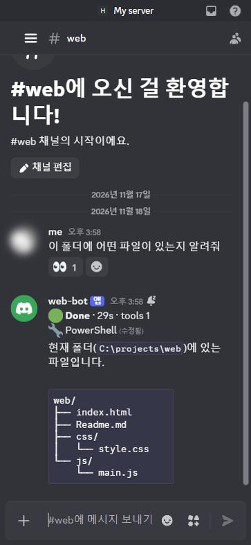
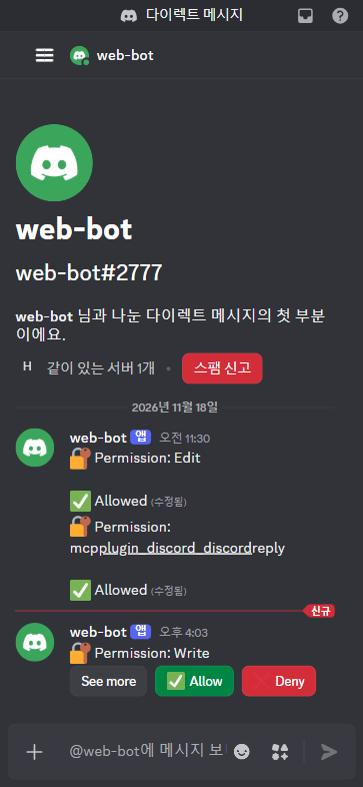
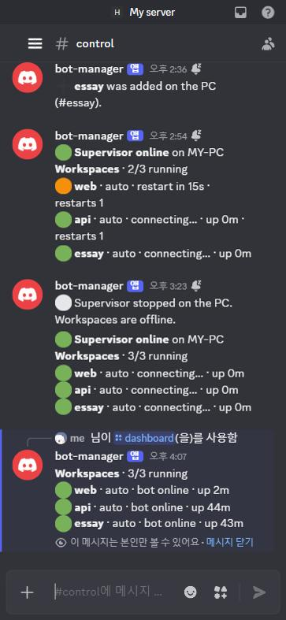
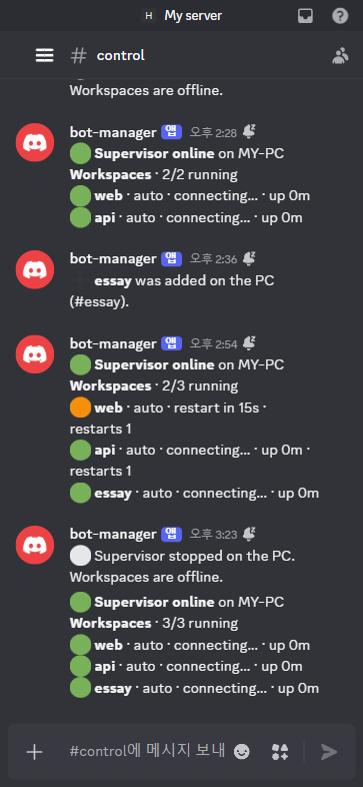

# 3. 사용법

## 작업 채널

워크스페이스 채널(예: `#web`)에 **그냥 메시지를 쓰면** 그 폴더의 Claude에게 전달됩니다. 멘션은 필요 없습니다.

| 보이는 것 | 의미 |
|---|---|
| 👀 리액션 | 메시지를 받음 |
| `🟡 Running · 0m 42s · tools 7` + 최근 도구 목록 | 진행 상태 메시지. 알림 없이 조용히 갱신됨 (도구를 쓰는 작업일 때만) |
| `🟠 Waiting for approval` | 승인이 필요함. 봇 DM을 확인 |
| `🟢 Done` / `🔴 Error` | 작업 끝 |
| 봇의 답장 | 결과. 이건 폰 알림이 울림 |

- **이미지·파일 첨부**도 보낼 수 있습니다.
- 대화는 이어집니다. PC나 실행 관리자를 다시 시작해도 **그 워크스페이스의 대화**를 계속합니다.
- 새 대화로 시작하려면 `#control`에서 `/new ws:web`.

### 승인 요청 (DM)
파일 수정이나 명령 실행에 승인이 필요하면 **그 워크스페이스의 봇이 DM으로** 🔐 요청과 **[See more] [Allow] [Deny]** 버튼을 보냅니다. 얼마나 자주 묻는지는 권한 모드로 정합니다.

### 권한 모드

| 모드 | 동작 |
|---|---|
| `auto` (기본) | 안전 분류기가 위험이 낮은 작업은 스스로 승인하고, 위험한 작업만 DM으로 물음 |
| `manual` | 파일 수정·명령 실행마다 DM으로 물음 (가장 안전) |
| `acceptEdits` | 파일 수정은 자동, 명령 실행은 DM으로 물음 |
| `plan` | 계획만 세우고 아무것도 바꾸지 않음 |

어떤 모드든 **디스코드로 답장·리액션·첨부 받기**(공식 플러그인의 도구)는 승인 없이 동작합니다. 내 채널로 답을 보내는 것뿐이라서입니다.

바꾸는 방법: 폰에서 `/mode ws:web mode:manual`, PC에서 `npm run mode -- web manual`, 또는 설정 페이지에서 워크스페이스를 다시 추가. 바꾸면 그 워크스페이스만 다시 시작되고 대화는 이어집니다 (진행 중이던 작업은 중단).

> 원격 조작이라 모든 확인을 건너뛰는 `bypassPermissions`, `dontAsk`는 일부러 지원하지 않습니다.

## 관리 채널 (`#control`, 관리용 봇)

명령은 등록한 내 계정만 쓸 수 있고, 답은 **나에게만 보이는 메시지**로 옵니다. 워크스페이스 이름(`ws`)은 자동완성됩니다.

| 명령 | 하는 일 |
|---|---|
| `/dashboard` | 모든 워크스페이스: 상태, 권한 모드, 봇 연결, 가동 시간, 재시작 횟수 |
| `/status ws:web` | 한 워크스페이스 상세 (폴더, 세션, 프로세스) |
| `/stop ws:web` | 진행 중인 작업만 중단 (Esc와 같음). 세션은 유지 |
| `/restart ws:web` | 다시 시작, 대화는 이어짐. `ws:all`이면 전체 |
| `/new ws:web` | 새 대화로 시작 |
| `/mode ws:web mode:manual` | 권한 모드 변경 |
| `/logs ws:web lines:25` | 최근 터미널 화면 (10~60줄) |
| `/ping` | PC 가동 시간, CPU, 메모리, 디스크, 절전 방지 |
| `/lockdown confirm:True` | 비상 정지: 모든 워크스페이스 중지. 다시 켜려면 `/restart ws:all` |

### 자동 알림

| 상황 | 알림 | 폰 알림 |
|---|---|---|
| 실행 관리자 시작 (재부팅 후 등) | 🟢 Supervisor online + 현황 | 조용히 |
| 워크스페이스 실패 (토큰 무효 등) | 🔴 이유와 해결 방법 | **울림** |
| 폴더 신뢰 확인 필요 | 🔐 PC에서 할 일 | **울림** |
| 디스코드 플러그인 연결 실패 | 🔴 오류 내용 | **울림** |
| 플러그인 복구 | 🟢 back online | 조용히 |
| 예기치 않은 종료 후 재시작 | 🟠 restarting | 조용히 |
| PC에서 워크스페이스 추가·삭제 | ➕ / ➖ | 조용히 |
| 실행 관리자 종료 | ⚪ Supervisor stopped | 조용히 |

## PC 명령 모음

| 명령 | 하는 일 |
|---|---|
| `npm run setup` | 설정 페이지 |
| `npm start` | 터미널에서 실행 (`Ctrl+C`로 종료) |
| `npm run start:bg` | 창 없이 백그라운드 실행 |
| `npm run stop` | 실행 관리자 종료 (터미널·백그라운드 모두) |
| `npm run status` | 상태 보기 |
| `npm run logs` | 백그라운드 로그 마지막 60줄 |
| `npm run autostart -- on` / `off` | Windows 로그인 시 자동 시작 켜기/끄기 |
| `npm run mode -- 이름 모드` | 권한 모드 변경 |
| `npm run trust -- 이름` | 폴더 신뢰 확인 창 열기 |
| `npm run check` | 준비물 점검 |
| `npm run add` / `add-manager` / `list` / `remove -- 이름` | 터미널에서 설정 |
| `npm start -- --fresh=web` | 특정 워크스페이스를 새 대화로 시작 |
| `npm run launch -- 이름` | 보이는 창으로 열기 (문제 확인용. 실행 관리자와 동시에 쓰지 말 것) |

실행 관리자가 켜져 있으면 설정 변경(워크스페이스 추가·삭제·봇 교체, 권한 모드, 관리용 봇)은 **재시작 없이 몇 초 안에** 반영됩니다.
